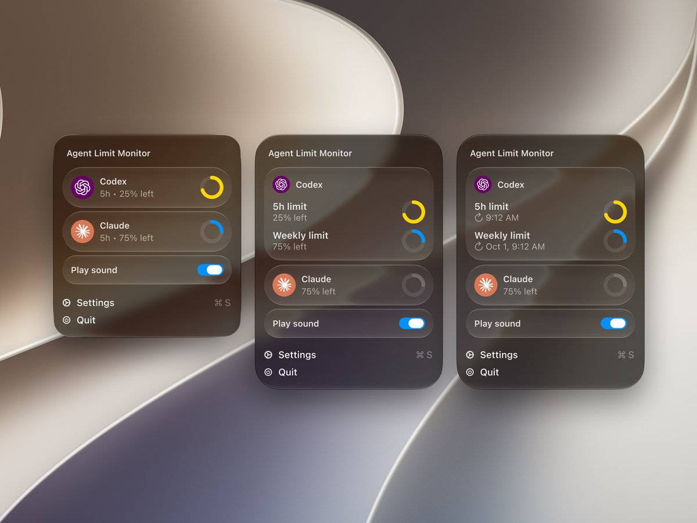

# Design inspiration

Visual references for the SidePulse desktop interface.

## Agent Limit Monitor by Creative Stefan

[Source post by @creativestefan on X](https://x.com/creativestefan/status/2110032425023897849) · Added October 13, 2026

The supplied reference shows three compact menu layouts for Codex and Claude usage limits, ranging from a single row per provider to an expanded card with separate five-hour and weekly limits.

Design details to draw from:

- Dark, translucent glass panels with soft shadows, thin borders, and generous corner radii.
- Rounded provider cards with recognizable icons, clear primary labels, and muted secondary information.
- Small circular progress rings with bright yellow and blue accents for glanceable status.
- Compact and expanded layouts that preserve the same visual hierarchy as more detail appears.
- Reset times placed beneath limit labels, with a small reset icon.
- A separate sound toggle row and lightweight Settings and Quit actions at the bottom.

Possible SidePulse application: use this card hierarchy and restrained status accents for a compact agent-status menu, with optional expanded usage details when available.
